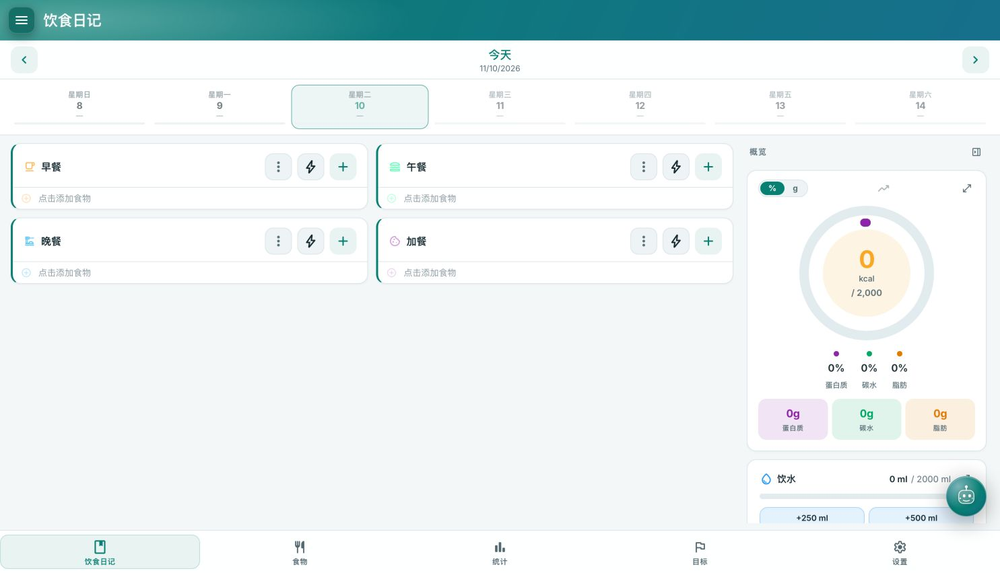

# NutriAgent

**Food logging, meal recognition, and an AI nutrition assistant.**

NutriAgent is a self-hosted personal nutrition tracker built on [NutriTrace](https://github.com/TraceApps/nutritrace). This version adds Simplified Chinese localization, the NutriAgent identity, a shared photo recognition workflow, refreshed colors, and the team's G31 meal recognition module.

Track meals and water, maintain a food library, review nutrition trends, or upload a meal photo to create a draft for review. The AI assistant and image recognition use separate configurations; enabling one does not enable the other.

[Features and usage](#features-and-usage) · [Quick start](#quick-start) · [Recognition engines](#recognition-engines) · [AI assistant](#ai-assistant) · [Development and verification](#development-and-verification) · [Project structure](#project-structure)



## Features and usage

| Feature | How to use it |
| --- | --- |
| Food diary | Add foods to breakfast, lunch, dinner, or snacks; adjust portions and review daily calories and nutrients. |
| Food library | Create or edit foods with photos, portions, nutrition, brands, barcodes, and notes. Reuse saved foods in the diary. |
| Meal photo recognition | Open the camera shortcut on Foods, select Meal photo and a recognition engine, then upload a photo and review the candidates. |
| Recognition inside the editor | Add a photo in the food editor and select Recognize this photo. Reuse the existing image and apply the reviewed result to the current form. |
| Nutrition label recognition | Select Nutrition label, use the configured OCR service, and check the nutrition basis and values before confirming. |
| AI assistant | Enable the assistant in Settings, configure a provider, model, and key, then use the floating assistant button. |
| Goals and statistics | Set calorie and nutrient goals and review intake trends. |
| Appearance and language | Switch between English and Simplified Chinese, light and dark themes, and desktop and mobile layouts. |

The project also retains upstream support for meals and recipes, offline logging and sync, imports and exports, account management, OIDC, wellness integrations, the Federation API, MCP, and an Android app. These features have their own configuration requirements. The G31 integration work did not revalidate every external service or Android hardware feature.

### Photo recognition workflow

1. Open **Foods → camera shortcut**, or select **Recognize this photo** in the food editor.
2. Choose a recognition type and an engine that supports it.
3. Upload a JPEG, PNG, or WebP image, up to 6 MiB.
4. Run recognition and check the candidate name, confidence, and actual portion.
5. Confirm the draft to open the food editor or apply it to the current form.
6. Review the values and save the food. Add it to the diary through the normal logging flow when needed.

Recognition does not automatically create foods or diary entries. Switching engines clears the previous result; switching candidates updates the associated reference portions and nutrition. Canceling recognition inside the editor leaves the original form intact. Applying a result preserves the existing food identity, brand, and existing notes.

## Quick start

### Option 1: Docker Compose

Requires Git, Docker, and Docker Compose. This repository builds a local image from source; it does not depend on a published NutriAgent image or APK.

```sh
git clone https://github.com/drive888/NutriAgent.git
cd NutriAgent
cp .env.example .env
mkdir -p data/db data/uploads
openssl rand -base64 48
```

For a new installation, set the following fields in `.env`. Use the random value generated above for `JWT_SECRET`. Existing deployments should retain their current secret and data paths.

```dotenv
DATA_DB_PATH=./data/db
DATA_UPLOADS_PATH=./data/uploads
JWT_SECRET=replace-with-your-generated-secret
```

Start the application:

```sh
docker compose up -d --build
```

Open **http://localhost:3001/** and complete the first-run setup. Meal recognition, label OCR, and the AI assistant each require their own service configuration. The application container does not start the Python model service.

The current development machine also has a separately configured preview at **http://localhost:3103/**. This is a local preview port, not the default repository Compose port. The original instance on 3101 remains separate, with its own data and service configuration.

### Option 2: Local development

Use Node.js 20 to match the Docker runtime. For G31, use a separate Python 3.12 virtual environment.

Install dependencies and create the configuration from the project root:

```sh
npm ci
npm ci --prefix server
cp .env.example .env
mkdir -p data/db data/uploads
```

Set `JWT_SECRET` in `.env` to a stable random value, then start the backend in one terminal:

```sh
DB_PATH=./data/db/development.db UPLOADS_PATH=./data/uploads \
  node --env-file=.env server/index.js
```

Start the frontend in another terminal:

```sh
npm run dev
```

Open the address printed by Vite, normally **http://localhost:5173/**. Vite proxies `/api` and `/uploads` to the backend on port 3001. Docker packages the production frontend for the backend; during development, use the Vite entry point.

## Recognition engines

**Recognition type** selects the task. **Recognition engine** selects the model or service that performs it. The selector reads the server registry: unconfigured engines are disabled, and engines that do not support the current task are omitted. A service failure produces an error instead of silently falling back to another engine.

| Engine ID | Display name | Supported types | Configuration |
| --- | --- | --- | --- |
| `legacy` | Standard recognition | Meal photo, nutrition label | `MEAL_RECOGNITION_URL`, `LABEL_RECOGNITION_URL` |
| `g31` | G31 · Food-101 | Meal photo | `G31_RECOGNITION_URL` |

### G31: run the team's meal recognition model

G31 uses EfficientNet-B0 / Food-101 and returns three dish candidates with temperature-calibrated confidence scores. Only the model service, 101-class weights, calibration, sample, and reference nutrition table were imported from the handoff package. The existing application was not replaced.

Run from the project root:

```sh
python3.12 -m venv .venv
.venv/bin/pip install -r tools/recognition-g31/requirements.txt
DEVICE=cpu .venv/bin/python -m uvicorn app:app \
  --app-dir tools/recognition-g31 --host 127.0.0.1 --port 3213
```

When the Node backend runs directly on the host, set this in `.env`:

```dotenv
G31_RECOGNITION_URL=http://127.0.0.1:3213/predict
```

When the backend runs in Docker Desktop or OrbStack and G31 runs on the Mac host, use a listening address reachable from the container:

```sh
DEVICE=cpu .venv/bin/python -m uvicorn app:app \
  --app-dir tools/recognition-g31 --host 0.0.0.0 --port 3213
```

Set the application environment to:

```dotenv
G31_RECOGNITION_URL=http://host.docker.internal:3213/predict
```

Restart a local Node backend after changing its environment. With the repository Compose setup, recreate the application container to load the new configuration:

```sh
docker compose up -d --force-recreate nutriagent
```

On Linux Docker, configure `host-gateway` for host access, or run the model on the same container network and connect by service name. G31 and the application are separate processes; both must be running.

Check the model service:

```sh
curl http://localhost:3213/health
curl -F image=@tools/recognition-g31/samples/pizza.jpg \
  http://localhost:3213/predict
```

See the [G31 module guide](tools/recognition-g31/README.md) for the API contract, dependency versions, model hash, and provenance.

### Portion and nutrition limits

G31 identifies dish categories. **It does not measure weight from a photo.** The bundled reference table covers 47 food classes, with approximate nutrition per 100g and small, medium, and large reference weights. Users can select a reference portion or enter grams manually.

For example, the table lists pizza at 266 kcal per 100g, so selecting 200g produces 532 kcal. This calculation does not establish that the photographed pizza weighs 200g or has the same nutritional composition. Missing food entries or nutrients remain unknown rather than becoming zero.

### Standard recognition and nutrition labels

The standard engine accepts JSON `{kind, image}` and uses separate meal and label service addresses:

```dotenv
MEAL_RECOGNITION_URL=http://your-service:8000/recognize
LABEL_RECOGNITION_URL=http://your-ocr-service:8000/recognize
```

The repository retains the [macOS recognition adapter](tools/recognition-macos/README.md): ONNX Food-101 for meals and Apple Vision OCR for labels. It has separate model, dependency, and operating-system requirements. G31 does not provide nutrition label OCR.

### Add another engine

Register a service that implements an existing protocol through the environment. No selector changes are needed:

```dotenv
RECOGNITION_ENGINES_JSON=[{"id":"another-model","name":"Another model","kinds":["meal"],"adapter":"json","url":"http://model:8000/recognize"}]
```

- `id`: a unique engine identifier, different from `legacy` and `g31`.
- `name`: the display name. Optional `nameZh` supplies a Simplified Chinese label.
- `kinds`: supported tasks, `meal` or `label`. The `g31` adapter supports only `meal`.
- `adapter`: `json` uses the existing JSON contract; `g31` uses multipart images and a `predictions` response.
- `url`: the endpoint accessed by the backend. Engine listing does not expose it to the browser.

A module with a different protocol needs a server adapter. Registration and forwarding are implemented in [`recognition-engines.js`](server/lib/recognition-engines.js) and [`recognition-service.js`](server/lib/recognition-service.js).

## AI assistant

Enable the assistant under **Settings → AI**, configure the provider, model, API address, and key, then test the connection. Supported provider types include OpenAI, Claude, Gemini, and OpenAI-compatible services. Photo conversations require image support; tool operations require tool-calling support from the selected model.

You can also configure the assistant on the server:

```dotenv
AI_ENABLED=true
AI_PROVIDER=oai-compat
AI_BASE_URL=https://your-provider.example/v1
AI_MODEL=your-model-id
AI_API_KEY=your-api-key
```

Environment configuration takes precedence over UI settings and locks the corresponding fields. G31 uses a local model and does not require this AI API key. Cloud assistants and external recognition services send request content to the configured provider; whether data leaves the machine depends on that configuration.

## Configuration and data

| Variable | Purpose |
| --- | --- |
| `DATA_DB_PATH`, `DATA_UPLOADS_PATH` | Host database and upload directories used by Compose. |
| `DB_PATH`, `UPLOADS_PATH` | Paths used by the Node backend. Repository Compose sets them to `/data/db/nutriagent.db` and `/data/uploads` inside the container. |
| `JWT_SECRET` | Session signing secret; keep it stable for an existing deployment. |
| `PORT` | Backend port, default 3001. |
| `BASE_URL`, `PUBLIC_URL` | Reverse-proxy subpath and public address used by features such as email links. |
| `INSECURE_COOKIES` | Set to `1` only when needed on a trusted plain-HTTP setup. Not needed for HTTPS deployments. |
| `G31_RECOGNITION_URL` | G31 `/predict` endpoint. |
| `MEAL_RECOGNITION_URL`, `LABEL_RECOGNITION_URL` | Standard meal recognition and label OCR endpoints. |
| `RECOGNITION_ENGINES_JSON` | Additional engine definitions. |
| `RECOGNITION_MODE` | `mock` explicitly simulates the standard engine for testing; it is not real recognition. |
| `AI_*` | Assistant enablement, provider, endpoint, model, and key. |

See [`.env.example`](.env.example) and [deployment notes](DEPLOY.md) for more options. Persist the database and uploads. Environment files, local credentials, personal databases, and Python virtual environments are excluded from version control.

Update an application built from this source:

```sh
git pull --ff-only
docker compose up -d --build
```

The backend applies database migrations at startup. Back up the database and uploads before updating. Rebuild this project's source image rather than using upstream image-pull instructions.

## Development and verification

```sh
npm test
npm run i18n:check
npm run i18n:check:zh
npm run build
```

Install both frontend and backend dependencies before running the full suite. Some tests depend on native modules or platform capabilities; skipped tests are not passes. Use isolated databases for integration tests rather than personal diary data.

G31 integration verification on **2026-11-10** included:

- Full regression: 961 tests, with 916 passing, 45 skipped, and no failures. English/Chinese coverage checks and the production build passed.
- Actual CPU loading of the supplied weights and recognition of the bundled pizza sample, including Top-3 candidates, reference-portion calculations, candidate switching, and editor prefill.
- Real-browser checks of English and Chinese, a 390px mobile layout, engine failure messages, and preservation of the original form when recognition is canceled.

One sample verifies that the integration runs; it does not establish independent recognition accuracy or mixed-meal performance. See the [G31 acceptance record](docs/g31-recognition-acceptance.md) for steps, limits, and screenshots.

The Android project is in `android/`. Run `npm run cap:sync` before opening it in Android Studio. Android source availability does not imply that this repository has published a signed APK or passed hardware testing in this round.

## Project structure

```text
src/
  routes/Recognition.svelte       Task, engine selection, and result review
  routes/FoodEditor.svelte        Food editing and photo reuse
  components/ai/                 AI assistant interface
  i18n/                          Translations
  lib/recognition-contract.js    Result validation and portion calculations
  lib/recognition-editor.js      Recognition draft prefill
server/
  routes/recognition.js          Recognition API, auth, and image validation
  lib/recognition-engines.js     Engine registry and capabilities
  lib/recognition-service.js     Provider calls and protocol adapters
  lib/recognition-g31.js         G31 candidate and reference-nutrition mapping
  data/g31-nutrition.json        Bundled approximate nutrition table
tools/
  recognition-g31/               G31 Python service, weights, and sample
  recognition-macos/             Existing macOS recognition adapter
scripts/                        Tests and development scripts
docs/                           Designs, acceptance records, and UI evidence
android/                        Capacitor Android project
```

## Documentation

- [G31 setup and extension guide](tools/recognition-g31/README.md)
- [G31 acceptance record](docs/g31-recognition-acceptance.md)
- [Photo recognition workflow acceptance](docs/photo-recognition-acceptance.md)
- [Localization acceptance](docs/localization-acceptance.md)
- [Project rename notes](docs/project-rename.md)
- [Architecture](ARCHITECTURE.md)
- [Public API](docs/public-api.md)
- [Deployment](DEPLOY.md)

Some deployment, roadmap, and historical documents are inherited from upstream. Check their release links and version plans against this repository's current state.

## Attribution and license

This project builds on [TraceApps/NutriTrace](https://github.com/TraceApps/nutritrace), retains upstream attribution and copyright notices, and uses [AGPL-3.0](LICENSE). See [LICENSES.md](LICENSES.md) for upstream integration and data-source notes. The G31 weights, calibration, sample, and approximate nutrition table come from the team's handoff package; provenance and modifications are documented in the [module guide](tools/recognition-g31/README.md).

Upstream also credits [Waistline](https://github.com/davidhealey/waistline) and [SparkyFitness](https://github.com/CodeWithCJ/SparkyFitness). Feature, release, and verification claims for this repository are defined by its current code and acceptance records.
